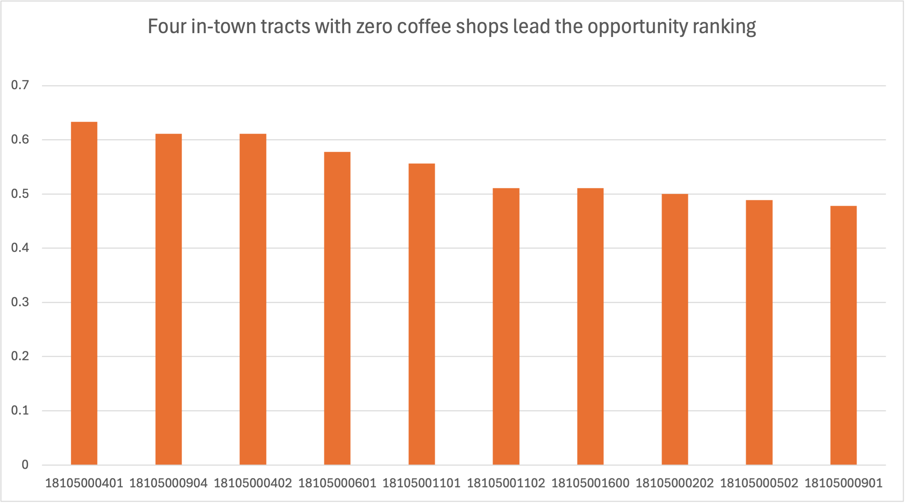
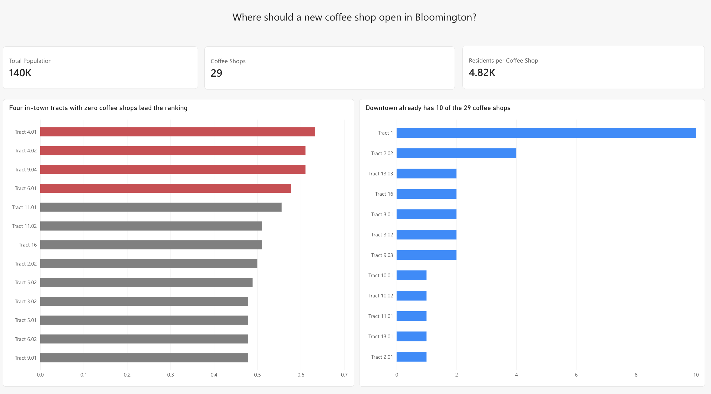
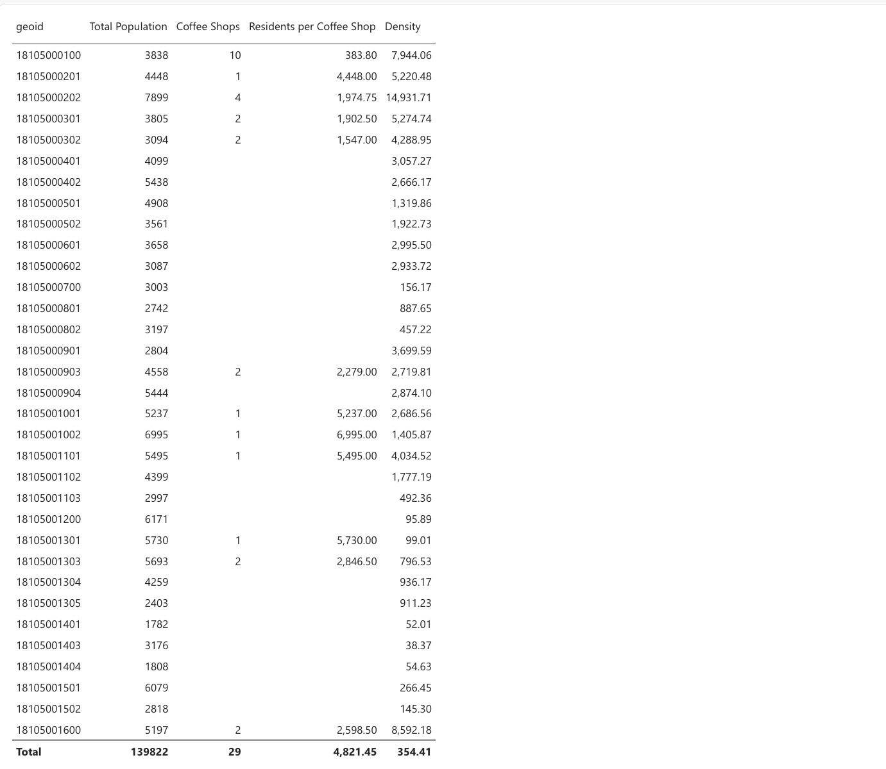

# Where should a new coffee shop open in Bloomington, Indiana?

A site-selection analysis of Monroe County census tracts using SQL (DuckDB) and Excel, built with free public data.

## 1. The question

A prospective coffee shop owner wants to know which neighborhoods in Bloomington have enough people nearby and little existing competition. This project ranks every in-town census tract on that question and checks the SQL results independently in Excel.

## 2. The data

| Source | What it gives | Limits |
|---|---|---|
| U.S. Census ACS 5-year estimates (2023), 33 Monroe County tracts | Population, median income (with margin of error), median age, median rent | Income in tracts dominated by IU students is very low but does not reflect spending power. Some margins of error exceed 50% of the estimate. |
| OpenStreetMap via the Overpass API, 283 places | Cafes, restaurants, fast food, bakeries, fitness centers with coordinates | Coverage is incomplete: a spot check found 7 of 15 known coffee places under the default tags. The pull only covers a Bloomington bounding box, so rural tracts can show zero places even when they have some. |
| Census TIGER/Line 2023 tract boundaries | Tract shapes and land area | None significant for this use. |

## 3. The method

Each place was assigned to a tract with a spatial join (`ST_Within`). Coffee competitors were defined with a flag that combines the OSM category, shop and cuisine tags, and name keywords such as "coffee", "espresso" and "roast", because the category alone missed many shops. Ten SQL queries in `sql/` profile the tracts, ending with an opportunity score (Q10). The score keeps only tracts with at least 1,000 people per square mile and weights three factors: 40% population density, 40% residents per coffee shop and 20% median income, each scaled by percentile rank.

**Why these weights:** density and competition carry most of the weight because a coffee shop depends on foot traffic and on not splitting that traffic with too many rivals. Income gets less weight because student tracts make it an unreliable signal in Bloomington. The first version used raw population and min-max scaling, which ranked large rural tracts first; switching to density, adding the urban filter and using rank-based scaling fixed that (see `stuck_log.md`).

## 4. The result



| Rank | Tract | People per sq mi | Coffee shops | Score |
|---|---|---|---|---|
| 1 | 18105000401 | 3,057 | 0 | 0.633 |
| 2 | 18105000904 | 2,874 | 0 | 0.611 |
| 2 | 18105000402 | 2,666 | 0 | 0.611 |

All three top tracts are dense, populated in-town areas with no coffee shop in the data. Downtown (18105000100) ranks last of 19 because it already has 10 coffee shops.

## 5. Caveats

- **Student income distortion:** tracts near campus show median incomes as low as $14,461.
- **OpenStreetMap coverage:** some real coffee shops are missing, so a "zero" tract should be checked on the ground before acting.
- **ACS margins of error:** tract 18105000904 (rank 2) has an income margin of error above 30% of the estimate, flagged `check` in the results.
- **Weights and the density cutoff are judgment calls.** Changing them changes the order below the top few.

## 6. How to reproduce

```bash
git clone https://github.com/adityabandal21/bloomington-site-selection.git
cd bloomington-site-selection
python3 -m venv .venv && source .venv/bin/activate
pip install duckdb pandas requests

# 1. Pull raw data (needs a free Census API key)
export CENSUS_API_KEY="your_key_here"
python notebooks/01_census_pull.py
python notebooks/02_osm_pull.py
# Download tl_2023_18_tract.zip from the Census TIGER/Line page and unzip it into data/raw/tracts/

# 2. Build the database
python notebooks/run_sql.py sql/01_load.sql
python notebooks/run_sql.py sql/02_clean.sql
python notebooks/run_sql.py sql/03_poi_tract.sql

# 3. Run the business questions
for f in sql/q*.sql; do echo "=== $f"; python notebooks/q.py "$f"; done

# 4. Export for Excel
python notebooks/run_sql.py sql/04_export.sql
```

The Excel check is in `bloomington_check.xlsx`: a pivot table and XLOOKUP reproduce Q3 (29 coffee shops), formulas reproduce Q4 and Q6, and conditional formatting reproduces Q5 (the same 7 tracts). OpenStreetMap data changes over time, so a fresh pull may give slightly different counts.

## 7. Power BI dashboard

The same analysis is rebuilt as an interactive Power BI report. Power Query loads the three clean CSVs straight from this repo, and a star schema links them on `geoid`: `tracts` at the center, `poi_tract` (one to many) and `opportunity_scores` (one to one). DAX measures (`Total Population`, `Coffee Shops`, `Residents per Coffee Shop`, `Land Sq Mi`, `Density`) replace the SQL aggregations.



A second page validates the model against SQL: 29 coffee shops in total, 383.8 residents per coffee shop downtown and 14,932 people per square mile in the densest tract, matching Q3, Q4 and Q6 exactly.



## Tools

SQL (DuckDB with the spatial extension), Python for data loading, Excel (Power Query, PivotTables, XLOOKUP, conditional formatting), Power BI (Power Query, data modeling, DAX), Git.
